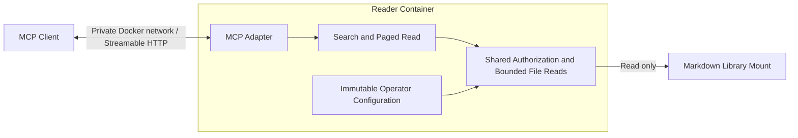

# MCP Reader Implementation Architecture

`library-reader-obsidian` provides read-only keyword search and paged original-text reads over an operator-selected subset of a local Markdown library (such as an Obsidian vault).

## Runtime and Deployment



The reader runs as a single Linux container process serving one configured library scope over stateless Streamable HTTP with JSON responses at `http://library-reader:8000/mcp` (configurable via `LRO_HOST`).

- **Process and filesystem hardening:** Run as non-root `UID:GID 10001:10001` with a read-only root filesystem (`--read-only`), dropped capabilities (`--cap-drop ALL`), `no-new-privileges`, no Docker socket, and no privileged device access. Mount the library at `/library:ro` and operator configuration at `/etc/lro/operator.json:ro`.
- **Host/Origin validation:** Transport security enforces exact `Host` (`library-reader:8000` by default) and `Origin` (`http://library-reader:8000`) headers without disabling DNS rebinding protection.
- **Protocol support:** Supports MCP `2025-11-25` and `2025-06-18` over stateless Streamable HTTP (`POST /mcp`).

## Implementation Structure

| File | Responsibility |
| --- | --- |
| `server.py` | Startup, two SDK tool registrations, input/output schemas, stable error mapping, response-size enforcement, and admission control |
| `config.py` | Validate operator configuration and fixed limits; no client overrides |
| `access.py` | Scope checks, enumeration, safe descriptor traversal, and bounded original-byte reads |
| `reader.py` | Literal search/ranking, fingerprints, page selection, and source-coordinate metadata |
| `tests/` | Independent fixture definitions, expected bytes/digests, and core/MCP/container tests |

Configuration binds before requests are served. It contains the vault `root`, `allow`/`deny` relative directories, and optional operator `ceilings`. Invalid or unsafe configuration prevents startup. Root, scope, and configuration selectors are absent from both tool schemas. All schemas reject extra properties, and strict validation rejects booleans or fractional values where integers are required.

## Scope, Candidates, and Read Outcomes

Size is not authorization. The reader separates scope policy from candidate readability:

- **In scope:** An exact relative path permitted by operator `allow`/`deny` rules and hidden-component exclusions.
- **Candidate note:** An in-scope Markdown file (`.md`, case-insensitive extension) satisfying filesystem safety rules (regular file, single hardlink `st_nlink == 1`, no symlinks/redirects, same device and mount).
- **Readable note:** A candidate successfully read within the source-byte cap, decoded as strict UTF-8, and not rejected for an observed during-read change in this operation.
- **Excluded entry:** Outside scope or disallowed by type, path, or link policy. Exclusions disclose no identifiers or counts and do not reduce scan coverage.

Search coverage is `complete` only if traversal of the authorized search area finished and every in-scope candidate could be evaluated. A candidate skipped for `too_large`, `invalid_encoding`, `io_error`, or `source_changed` makes coverage `partial`; an in-scope directory that cannot be enumerated also makes coverage `partial`. Budget exhaustion (`scan_budget`) makes coverage `partial`. Limiting returned hits by `limit` or `response_budget` does not reduce scan coverage.

For direct reads (`library_read`), excluded or missing references return `unavailable`; a candidate exceeding the source cap returns `too_large`; invalid UTF-8 returns `invalid_encoding`; and I/O failure returns `io_error`. Authorization is applied before revealing any read outcome.

## Default Budgets and Ceilings

All byte sizes use binary units (`1 KiB = 1024 bytes`, `1 MiB = 1,048,576 bytes`). An operator can lower (but not raise) these ceilings in `/etc/lro/operator.json`.

| Budget | Default / Maximum | Meaning |
| --- | --- | --- |
| `source_bytes` | 1 MiB (`1,048,576`) | Maximum raw bytes accepted from one candidate note for search or read |
| `page_bytes` | 32 KiB (`32,768`) | Default and maximum original UTF-8 text bytes returned in one `library_read` page |
| `envelope_bytes` | 256 KiB (`262,144`) | Maximum serialized UTF-8 `CallToolResult` size (including both `structuredContent` and JSON text block) |
| `query_chars` | `256` | Maximum Unicode characters in a search query |
| `query_terms` | `16` | Maximum non-empty whitespace-delimited search terms |
| `hits` | Default `20`, max `50` | Maximum search hits returned per call (also subject to `envelope_bytes`) |
| `excerpt_bytes` | `320` | Maximum UTF-8 bytes in a search hit excerpt, never splitting a code point or CRLF |
| `scan_ms` | `2,000` ms | Cooperative scan deadline before returning `coverage="partial"` with `stop_reason="scan_budget"` |

## Public MCP Contract

```python
library_search(query: str, limit: int = 20)
library_read(
    note_id: str,
    expected_digest: str | None = None,
    offset: int = 0,
    max_bytes: int = 32768,
)
```

- `offset` is a zero-based raw UTF-8 byte position.
- `max_bytes` is a ceiling on returned source bytes (`4 .. 32768`, or lower operator ceiling). Out-of-range values are rejected at schema/input validation (`-32602`), never clamped.
- Both tools declare input and output JSON schemas and annotations `readOnlyHint=true`, `destructiveHint=false`, `openWorldHint=false`.
- Tool calls return both `structuredContent` and an equivalent compact JSON string in one `TextContent` block.
- Operational failures return `isError=true` with a stable `status` and sanitized `message`:

| Status | Meaning |
| --- | --- |
| `unavailable` | Missing or excluded note; identical public result |
| `source_changed` | Valid supplied digest differs, or an observable concurrent change prevented a stable read; no body; obtain a fresh search reference |
| `invalid_digest` | Supplied string is not 64 hexadecimal characters; no body |
| `too_large` | Candidate exceeds `source_bytes`; no body |
| `invalid_encoding` | Candidate within `source_bytes` is not strict UTF-8 |
| `invalid_range` | Invalid byte offset/boundary, or missing `expected_digest` when `offset > 0` |
| `io_error` | Authorized read failed; no raw exception or host path |
| `response_limit` | Minimal metadata plus a progressing page cannot fit, or the top-ranked search hit cannot fit |
| `busy` | Another reader operation is currently active |

The server admits one active reader operation at a time; concurrent calls receive `status="busy"` immediately without queueing unbounded worker threads.

## Shared Access Boundary

Both `library_search` and `library_read` traverse the filesystem through `Access`:

1. **Prefix rules:** `allow` and `deny` prefixes match whole path components. `deny` wins over `allow`. Any path component starting with `.` is excluded, as are control characters, surrogates, backslashes, colons, and empty components.
2. **Descriptor-relative traversal:** The root directory is pinned with `os.open(config.root, O_RDONLY | O_DIRECTORY | O_NOFOLLOW)`. Each path component is verified for exact directory-entry spelling (`os.scandir`) to prevent case-insensitive or Unicode-normalization aliasing on host shares, then opened descriptor-relative (`dir_fd`) without following symlinks.
3. **File and mount verification:** Every directory and note descriptor is checked against the pinned root's device (`st_dev`) and Linux mount ID (`statx` or `/proc/self/fdinfo/<fd>`). Candidate notes must be regular files (`S_ISREG`) with `st_nlink == 1`.
4. **Bounded read and revision check:** `_source` reads at most `source_bytes + 1` bytes from the opened descriptor, compares descriptor revision metadata (`st_dev`, `st_ino`, `st_mode`, `st_nlink`, `st_size`, `st_mtime_ns`, `st_ctime_ns`) before and after the read, revalidates the live ancestor path after reading, and decodes strict UTF-8 (preserving any UTF-8 BOM as `U+FEFF`).

## Search Algorithm and Result Schema

- **Normalization:** Query terms, filename stems, and note bodies are normalized with `NFC(NFC(text).casefold())`. Every distinct query term must occur in either the filename stem or the note body.
- **Ranking:** Hits are ordered by the number of distinct query terms matching the filename stem (descending), then by exact relative `note_id` in Unicode code-point order (ascending).
- **Excerpts:** For hits matching in the body, the first matching line provides one bounded original-text excerpt (`<= 320` UTF-8 bytes) with 1-based `line` and 0-based byte `offset` mapped back to the original UTF-8 buffer. Filename-only matches omit `excerpt`.

```json
{
  "status": "ok",
  "hits": [
    {
      "note_id": "Guides/Restore.md",
      "title": "Restore",
      "digest": "64-char-lowercase-sha256",
      "excerpt": {
        "text": "restore backup from cold storage\n",
        "line": 1,
        "offset": 0,
        "truncated": false
      }
    }
  ],
  "coverage": "complete",
  "stop_reason": null,
  "scanned_notes": 6,
  "skips": {},
  "matched_scanned": 1,
  "limited": false,
  "limit_reason": null
}
```

## Paged Read Algorithm and Result Schema

1. Reauthorize `note_id` and read the bounded original byte buffer, computing its lowercase whole-file SHA-256 `digest`.
2. If `expected_digest` is provided, validate its 64-hex-character format (`invalid_digest` if malformed) and compare to `digest` (`source_changed` if different). Require `expected_digest` whenever `offset > 0`.
3. Verify `0 <= offset <= total_bytes` at a valid UTF-8 code-point boundary and not inside a `\r\n` pair (`invalid_range` otherwise).
4. Find the largest safe UTF-8/CRLF boundary within `offset + max_bytes` whose complete serialized MCP response fits within `envelope_bytes`. For non-EOF pages, prefer the last `\n` boundary within that capacity `C` if it returns at least `ceil(C / 2)` bytes (50% minimum-fill rule); otherwise return the full safe prefix `C`.

```json
{
  "status": "ok",
  "note_id": "Guides/Restore.md",
  "digest": "64-char-lowercase-sha256",
  "text": "restore backup from cold storage\n",
  "returned_bytes": 33,
  "range": {
    "start_byte": 0,
    "end_byte": 33,
    "start_line": 1,
    "end_line": 1
  },
  "total_bytes": 33,
  "total_lines": 1,
  "next_offset": null,
  "has_more": false,
  "complete_note": true
}
```
