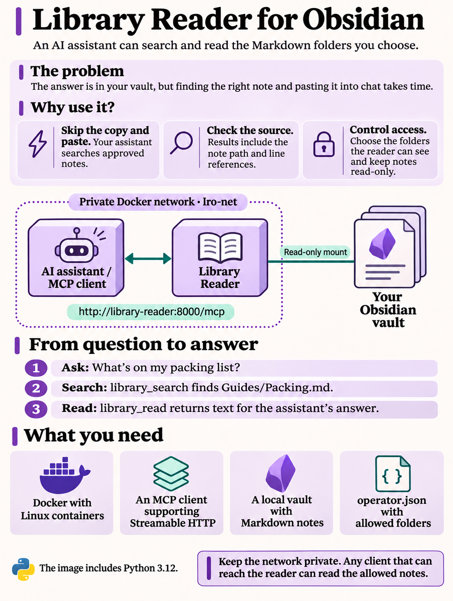

# Library Reader for Obsidian

Library Reader lets an AI assistant search and read Markdown notes in the Obsidian folders you choose. It runs as a read-only Docker service. You connect your assistant through the Model Context Protocol (MCP).

If you remember writing a packing list but forget where you saved it, ask your assistant to find it. Library Reader can search for “packing,” return the matching note path, and read the relevant lines. You can check the answer against the original note and skip copying passages into chat.



## Before you connect a vault

**Any client that can reach the service can read the allowed notes.** The reader has no built-in login or per-user permissions. The setup below keeps it on an internal Docker network with no published host port. Connect only trusted clients. If you need broader access, use an authenticating reverse proxy.

Choose folders whose **filenames, contents, and YAML frontmatter** are appropriate to share with the assistant. The reader sends original text to the client. A denied folder stays excluded even when its parent is allowed.

## Quick start with a sample note

You need Docker with Linux containers, a shell, and an MCP client that supports **Streamable HTTP**. This example uses a client running in another container on the same Docker host. The reader image includes Python 3.12.

### 1. Build the reader and prepare a sample vault

Open a shell in the repository root. The commands below create a temporary vault so you can try a search before connecting personal notes. Run them in the same shell.

```sh
docker build -t library-reader-obsidian:latest .
sample_dir=$(mktemp -d)
mkdir -p "$sample_dir/vault/Guides"
printf '%s\n' 'Packing list: bring a rain jacket.' > "$sample_dir/vault/Guides/Packing.md"
cp operator.example.json "$sample_dir/operator.json"
chmod 755 "$sample_dir/vault" "$sample_dir/vault/Guides"
chmod 644 "$sample_dir/vault/Guides/Packing.md" "$sample_dir/operator.json"
```

The example configuration allows `Guides` and excludes `Guides/Restricted`. Paths in those lists are relative to the vault. [Example configuration](operator.example.json)

### 2. Start the reader on a private network

Create the network once. If you already created `lro-net` as an internal network for this service, reuse it.

```sh
docker network create --driver bridge --internal lro-net
docker run -d --name library-reader \
  --network lro-net --network-alias library-reader \
  --read-only --cap-drop ALL --security-opt no-new-privileges \
  --user 10001:10001 --memory 256m --cpus 1 --pids-limit 64 \
  --mount "type=bind,src=$sample_dir/vault,dst=/library,readonly" \
  --mount "type=bind,src=$sample_dir/operator.json,dst=/etc/lro/operator.json,readonly" \
  library-reader-obsidian:latest
```

### 3. Connect your assistant and try a search

Attach your existing MCP client container to the same network. Replace `my-mcp-client` with its container name.

```sh
docker network connect lro-net my-mcp-client
```

In the client's MCP server settings, choose **Streamable HTTP** and enter **`http://library-reader:8000/mcp`**. Docker resolves `library-reader` inside this network. A desktop client running directly on the host needs a different connection setup.

Ask your assistant: **“Search my library for ‘packing’. What should I bring? Include the note path.”** A successful answer mentions the rain jacket and `Guides/Packing.md`. Behind the scenes, `library_search` finds the note by keyword and `library_read` retrieves its text.

### 4. Switch to your own vault

Stop and remove the sample reader with `docker rm -f library-reader`. Run the same container command again, replacing the two `src=` values with absolute paths to your vault and your own `operator.json`. Keep the destinations and read-only mounts as shown. The container user (UID/GID 10001) needs permission to traverse the selected directories and read the chosen notes and configuration.

## If something goes wrong

| What you see | What to check |
| --- | --- |
| The client cannot connect | Confirm both containers are on `lro-net` and use the exact endpoint above. Inside the client container, `localhost` points to the client itself. |
| A note is missing | Check the spelling of the allowed folder and the search terms. All terms must occur in the filename stem or note text. Hidden paths, symlinks, and hardlinked files are excluded. |
| Search reports `partial` | The reader reached a scan limit or skipped an eligible file. A missing match in a partial scan is inconclusive. |

## Technical reference

| Guide | When to use it |
| --- | --- |
| [Architecture](Architecture.md) | Understand folder access checks, configuration limits, and the MCP response format. |
| [Tool descriptions](TOOL_DESCRIPTIONS.md) | Integrate search and paged reads into an MCP client. |
| [Data quality](DATA_QUALITY.md) | Interpret excerpts, coverage, and revision fingerprints. |
| [Test plan](TEST_PLAN.md) | Review the filesystem, transport, and performance checks. |

## Running the Test Suite

### 1. Local Python Unit & MCP Tests

Using Python 3.12+ in a virtual environment with `requirements.lock` installed (run as a non-root user):

```sh
python -m pip install --only-binary=:all: --require-hashes -r requirements.lock
PYTHONPATH=.:tests python -B -m unittest discover -s tests -v
```

### 2. Full Container, Bind-Mount & Write-Denial Suite

Run the end-to-end isolated Linux container and read-only bind-mount verification suite:

```sh
sh tests/container_trial.sh local
```

### 3. Synthetic 1,000-Note (10 MiB) Performance Benchmark

On a Docker Desktop host, run the five-call MCP search performance gate and mount write-denial check:

```sh
python3 -B tests/benchmark.py
```

---

## License

Released under the [MIT License](LICENSE).
